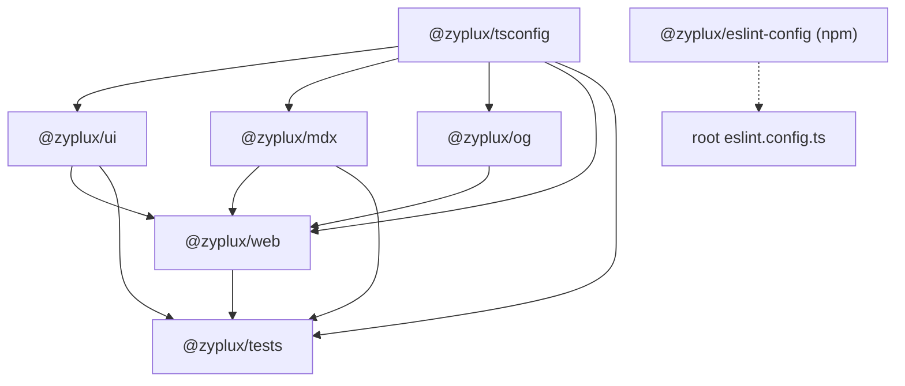

# Monorepo Setup

**Stack:** pnpm workspaces + TypeScript project references + ESLint (Flat Config, published `@zyplux/eslint-config`)

## Package Structure

_How do the workspace packages depend on each other?_

- `apps/web` — React marketing site with TanStack Start file routes, MDX page content, and prerendering for Cloudflare Workers.
- `packages/ui` — shared design tokens, global styles, class recipes, and React components; see the [UI package guide](packages/ui/README.md) for its public API.
- `packages/mdx` — MDX compile pipeline: `MDX_OPTIONS` (gfm + frontmatter + sections) and the `remarkSections` plugin that groups `##` headings into `<Section>`/`<Intro>` JSX
- `packages/og` — node-side social-card rendering kit: Inter font loading, satori/resvg `renderCardPng`, svg→png data URIs, grid background generator
- `packages/tsconfig` — shared TypeScript presets (`base.json`, `node.json`, `web.json`)
- `tests` — Vitest stories against public package interfaces, with fixtures in `tests/src/fixtures` and browser harnesses in `tests/src/web`.

## Web App Structure

- `apps/web/content` — MDX pages and insight posts; page frontmatter types live in `apps/web/src/mdx.d.ts`.
- `apps/web/src/site.ts` — brand strings and chrome copy; `config.ts` holds the site URL, theme color, and social image dimensions.
- `apps/web/src/components` — site bindings for shared layout, forms, and MDX components, plus brand-specific compositions such as the system map.
- `apps/web/src/routes` and `router.tsx` — file routes; each route builds its page head from MDX frontmatter.
- `apps/web/og` — insight metadata and social image Vite plugins.

## TypeScript Configuration

- Root [tsconfig.json](tsconfig.json) references the workspace projects; typechecking runs `tsc -b`.
- Every project extends a strict [shared preset](packages/tsconfig/base.json), with declaration output and build metadata in `.tsbuild/`; `node.json` and `web.json` add environment types.
- [tsconfig.tooling.json](tsconfig.tooling.json) covers root configuration and scripts; [apps/web/tsconfig.node.json](apps/web/tsconfig.node.json) covers Vite configuration, social image plugins, and app scripts.

## Linting

Root [eslint.config.ts](eslint.config.ts) consumes `@zyplux/eslint-config` for TypeScript, React, and MDX. [.remarkrc.mjs](.remarkrc.mjs) combines the same MDX plugins used by Vite and Vitest with Remark lint rules. Rumdl checks Markdown, and Cerberus enforces shared repository rules.

## Dependency Management

Version ranges are centralized in the `catalog` of [pnpm-workspace.yaml](pnpm-workspace.yaml); packages reference them as `"catalog:"`. Workspace packages use `workspace:*`. Shared Python tools are declared in [pyproject.toml](pyproject.toml) and locked in `uv.lock`.

## Runtime and Build

Node.js runs the local toolchain and CI. [package.json](package.json) pins pnpm through `packageManager` and the Node.js runtime through `devEngines.runtime`.

The website runs on Cloudflare Workers, configured in [wrangler.jsonc](apps/web/wrangler.jsonc). [vite.config.ts](apps/web/vite.config.ts) uses the Cloudflare plugin for development and prerendering, defines browser targets, and generates the sitemap and social share images.

## Tests and CI

[vitest.config.ts](vitest.config.ts) configures MDX compilation, happy-dom, and coverage thresholds. Numbered story tests have matching Markdown scenarios and share setup through Vitest fixtures.

[CI](.github/workflows/ci.yml) and [deployment](.github/workflows/deploy.yml) use the shared package-manager setup action. The [review gate](.github/workflows/org_gate.yml) receives dispatches from the shared GitHub webhook Worker.

See [Getting Started](README.md) for prerequisites and commands, and [Coding Guidance](OVERVIEW.md) for contribution conventions.
